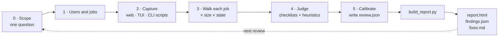

<p align="center">
  
</p>

<p align="center">
  <a href="#-install"></a>
  <a href="#claude-code"></a>
  
  
</p>

<p align="center">
  <b><a href="#-quick-start">Quick start</a></b> ·
  <a href="#-install">Install</a> ·
  <a href="#-use-it">Use it</a> ·
  <a href="#-what-you-get">What you get</a> ·
  <a href="#-how-it-works">How it works</a> ·
  <a href="ARCHITECTURE.md">Architecture</a>
</p>

---

**uiux-review** is an [Agent Skill](https://agentskills.io) that turns your AI coding agent into a UI/UX lead. Instead of guessing from CSS, it **runs your product**, captures real screens at phone, tablet, laptop and desktop sizes, in light and dark mode, in empty, error, offline and slow states. Then it reports what slows down, confuses or misleads your users, with a screenshot, a priority and an effort size for every finding.

It works on three kinds of product:

| 🌐 **Web apps** | 🖥️ **Terminal UIs** | ⌨️ **CLIs** |
|---|---|---|
| Playwright captures at 4 sizes × light/dark, plus 200% zoom and reduced motion. axe-core a11y, overflow, tap-target size and a Tab-key focus walk. | Textual pilot or any pty app (curses, Bubble Tea, Ratatui…) at 80×24, 120×40 and 200×60, with cut-off text detection. | `--help` at 80 cols, bad flags, bad input, piped vs tty, `NO_COLOR`, `TERM=dumb`, exit codes, all with timeouts in a scratch `HOME`. |

## ⚡ Quick start

In **Claude Code**:

```text
/plugin marketplace add shankarThiyagaraajan/claude_skill_uiux_review
/plugin install uiux-review@shankar-skills
```

Start your app, then just ask:

```text
Review the UI of my app at http://localhost:3000. Quick pass, focus on sign-up and checkout.
```

Using a different agent? Jump to [Install](#-install). The skill is a plain `SKILL.md` folder, so it works anywhere Agent Skills are supported.

## 📦 Install

| Agent | Fastest way | Invoke with |
|---|---|---|
| [Claude Code](#claude-code) | `/plugin install` (above) | ask in plain words, or `/uiux-review:uiux-review` |
| [Claude.ai / Desktop](#claudeai-and-claude-desktop) | upload a `.zip` in Skills settings | ask in plain words |
| [Claude API](#claude-api) | `client.skills.create(...)` | `container.skills` |
| [Claude Agent SDK](#claude-agent-sdk) | copy into `.claude/skills/` | ask in plain words |
| [OpenAI Codex](#openai-codex) | clone into `~/.agents/skills/` | `$uiux-review` |
| [Gemini CLI](#gemini-cli) | `gemini skills install <repo>` | ask in plain words |
| [Cursor](#cursor) | clone into `~/.cursor/skills/` | `/uiux-review` |
| [GitHub Copilot](#github-copilot) | clone into `~/.copilot/skills/` | ask in plain words |

> [!TIP]
> **One folder for many agents.** Codex, Gemini CLI, Cursor and GitHub Copilot all read `~/.agents/skills/`. Clone once there, and symlink it for Claude Code:
>
> ```sh
> git clone https://github.com/shankarThiyagaraajan/claude_skill_uiux_review.git ~/.agents/skills/uiux-review
> mkdir -p ~/.claude/skills && ln -s ~/.agents/skills/uiux-review ~/.claude/skills/uiux-review
> ```
>
> Keep the folder named `uiux-review`. Several agents expect the folder name to match the skill's `name`.

### Claude Code

**As a plugin (recommended: one command to update).** Inside a session:

```text
/plugin marketplace add shankarThiyagaraajan/claude_skill_uiux_review
/plugin install uiux-review@shankar-skills
```

Or from your shell:

```sh
claude plugin marketplace add shankarThiyagaraajan/claude_skill_uiux_review
claude plugin install uiux-review@shankar-skills
```

Update later with `claude plugin update uiux-review@shankar-skills`.

**As a plain skill.** For you only, or for everyone on a project:

```sh
# just you, every project
git clone https://github.com/shankarThiyagaraajan/claude_skill_uiux_review.git ~/.claude/skills/uiux-review

# this project only (commit it so your team gets it too)
git clone https://github.com/shankarThiyagaraajan/claude_skill_uiux_review.git .claude/skills/uiux-review
```

Start a new session and the skill is picked up. As a plain skill its slash command is `/uiux-review`.

### Claude.ai and Claude Desktop

Custom skills need a paid plan with **code execution** turned on.

1. Build the zip. The top folder must be named `uiux-review`:

   ```sh
   git clone --depth 1 https://github.com/shankarThiyagaraajan/claude_skill_uiux_review.git uiux-review
   zip -r uiux-review.zip uiux-review -x 'uiux-review/.git/*' 'uiux-review/.claude-plugin/*' 'uiux-review/assets/*'
   ```

2. In Claude, open **Customize → Skills**, click **+**, choose **Upload a skill** and pick `uiux-review.zip`. On older layouts it's under **Settings → Capabilities → Skills**.

> [!NOTE]
> Claude.ai runs the skill in a cloud sandbox, which **cannot reach an app on your `localhost`**. There it is best for judging screenshots, terminal dumps or command transcripts you upload, and for building the report. For live captures, use a local agent such as Claude Code.

### Claude API

Upload the folder once. The `name` in `SKILL.md` is already API-safe.

```python
import anthropic
from anthropic.lib import files_from_dir

client = anthropic.Anthropic()
skill = client.skills.create(files=files_from_dir("uiux-review"))  # a clean copy, without .git/
print(skill.id)
```

Then attach it to a request with the code execution tool:

```python
response = client.messages.create(
    model="claude-opus-5-5",
    max_tokens=8192,
    container={"skills": [{"type": "custom", "skill_id": skill.id, "version": "latest"}]},
    tools=[{"type": "code_execution_20250825", "name": "code_execution"}],
    messages=[{"role": "user", "content": "Review these CLI transcripts for usability: ..."}],
)
```

Like Claude.ai, the API sandbox can't reach your machine. Feed it captures and transcripts, or use a local agent for live runs. See the [Skills guide](https://platform.claude.com/docs/en/build-with-claude/skills-guide) for versions and limits.

### Claude Agent SDK

Put the skill in your project's `.claude/skills/uiux-review/` (or `~/.claude/skills/`), then let the agent load skills from settings and allow the `Skill` tool:

```python
from claude_agent_sdk import query, ClaudeAgentOptions

options = ClaudeAgentOptions(
    setting_sources=["user", "project"],
    allowed_tools=["Skill", "Read", "Write", "Bash", "Glob", "Grep"],
)

async for message in query(prompt="Run a quick UX review of http://localhost:5173", options=options):
    print(message)
```

### OpenAI Codex

Codex reads `~/.agents/skills/` (all projects) and `.agents/skills/` (one repo):

```sh
git clone https://github.com/shankarThiyagaraajan/claude_skill_uiux_review.git ~/.agents/skills/uiux-review
```

Invoke it with `$uiux-review`, pick it from `/skills`, or just ask for a UX review.

### Gemini CLI

```sh
gemini skills install https://github.com/shankarThiyagaraajan/claude_skill_uiux_review --scope user
```

Or clone it into `~/.gemini/skills/uiux-review` (or `~/.agents/skills/uiux-review`). Check that it loaded with `/skills list`.

### Cursor

```sh
git clone https://github.com/shankarThiyagaraajan/claude_skill_uiux_review.git ~/.cursor/skills/uiux-review
```

Use `.cursor/skills/` for one project. In Agent chat, type `/uiux-review`, or let Cursor pick it up when you ask for a UX review. Cursor also reads `~/.claude/skills/` and `~/.agents/skills/`.

### GitHub Copilot

```sh
# personal, all projects
git clone https://github.com/shankarThiyagaraajan/claude_skill_uiux_review.git ~/.copilot/skills/uiux-review

# or per repository
git clone https://github.com/shankarThiyagaraajan/claude_skill_uiux_review.git .github/skills/uiux-review
```

Works in Copilot CLI, agent mode in VS Code, Visual Studio and JetBrains, and the Copilot cloud agent (repository skills).

### Any other agent

If your tool doesn't support Agent Skills yet, clone the repo anywhere and say:

```text
Read /path/to/uiux-review/SKILL.md and follow it to review my app at http://localhost:3000.
```

## 🐍 One-time setup: capture tools

The skill drives your app with small Python scripts (Python 3.9 or later). Install their dependencies in a throwaway venv **outside** your project:

```sh
python3 -m venv ~/.venvs/uiux-review
~/.venvs/uiux-review/bin/pip install playwright axe-playwright-python pillow   # web
~/.venvs/uiux-review/bin/pip install textual pyte pexpect pillow               # TUI
```

The CLI runner and report builder need only the standard library. For web reviews, the capturer uses your installed Chrome when it can. If not, run `~/.venvs/uiux-review/bin/python -m playwright install chromium`.

Check that a browser launches:

```sh
~/.venvs/uiux-review/bin/python ~/.agents/skills/uiux-review/scripts/capture_web.py --check
```

Tell your agent where the venv is ("use `~/.venvs/uiux-review/bin/python`") and it will take it from there.

## 🚀 Use it

Start your app with **seeded or test data**, then ask in your own words. Some prompts that work well:

```text
Review the UI of http://localhost:3000. Quick pass, sign-up flow only.
```

```text
Full UX review of the dashboard at http://localhost:8080. Jobs: create a report,
share it, export CSV. Test account: demo@example.test / demo. Check mobile too.
```

```text
Is our CLI friendly? The command is `mytool`. Read-only subcommand: `mytool list`.
```

```text
Review the TUI: `python -m myapp.tui`. Users run it over SSH on small terminals.
```

```text
Re-review the app. The last findings are in docs/reviews/uiux/2026-10-15/findings.json.
```

The skill asks **one** scoping question at the start: how to run the app, which 3–5 jobs matter, where earlier reviews are, and how deep to go. Then it works without interrupting you.

| Depth | What it covers | Good for |
|---|---|---|
| `quick` | the main job at one size, about 15 captures | a pre-merge sanity check |
| `full` | every job × every size × every state | a pre-release review |

## 🎁 What you get

Every review writes three files beside `review.json`:

| File | What's in it |
|---|---|
| 📊 **`report.html`** | Verdict, a contact sheet of every screen, a scorecard per dimension, quick wins, findings with annotated screenshots, the job × state matrix, and what *wasn't* checked |
| 🗂️ **`findings.json`** | A cumulative ledger. IDs (`UX-001`, `UX-002`…) are never reused, so the next review re-tests each open item and marks it *Fixed*, *Regressed* or *Open* |
| 🛠️ **`fixes.md`** | A to-do list of every open item with **Where / Do / Verify**, ready to hand to your coding agent |

Each finding includes:

- **Priority:** P0 (crash, data loss, money, misleading state) to P3 (polish), weighed by how many users hit it and how often.
- **Evidence tag:** `automated` (measured), `judged` (seen on a capture) or `inferred` (from code, so capped at P1).
- **Effort:** S, M or L. No sprint plans, since most fixes will be done by an AI.
- **Level:** the smallest place that fixes it: token, component, pattern, screen, copy or flow. A defect repeated on ten screens is filed once, at its shared cause.

## 🔍 How it works



Machines measure what they can (overflow, contrast, focus order, exit codes). The agent spends its judgment on what they can't: whether a label makes sense, whether a number is stale, whether "stopped" looks like "failed". Findings are tagged with Nielsen heuristics or WCAG 2.2 criteria where that helps, so a reviewer can look up the reasoning.

## 🛡️ Safe by design

- **Read-only.** The review changes no code. Writing states (submit, delete, purchase) are tested only after the agent confirms the backend is local or disposable.
- **No real data.** Seeded data and local test accounts only. The product makes no paid or external calls during the review.
- **Secrets stay out of the evidence.** Password and card fields are masked, URL query strings stripped, tokens redacted from console logs, and secret-looking environment variables dropped. The report builder **refuses to build** if it finds a key, token or real-looking email address.
- **Sandboxed CLI probes.** Every CLI run has a timeout, its own process group, a scratch `HOME` and no shell.

The secret scan is a safety net, not a guarantee. Look over settings, profile and billing screens yourself before you share a report.

## 🗺️ What's inside

```text
uiux-review/
├── SKILL.md                 ← the skill: workflow, dimensions, severity, report rules
├── scripts/
│   ├── capture_web.py       Playwright captures + axe, overflow, targets, focus walk
│   ├── capture_tui.py       Textual / pty snapshots at terminal sizes
│   ├── run_cli.py           safe CLI ergonomics probes (run_cli.sh wraps it)
│   ├── annotate.py          numbered callouts on a screenshot
│   └── build_report.py      review.json → report.html + findings.json + fixes.md
├── references/              checklists (web, TUI, CLI), heuristics, state matrix, schema
├── .claude-plugin/          Claude Code plugin + marketplace manifests
└── ARCHITECTURE.md          data flow, invariants and side effects, for contributors
```

## 🤝 Contributing

Issues and pull requests are welcome. Before you open a PR:

```sh
python3 -m py_compile scripts/*.py && sh -n scripts/run_cli.sh   # syntax check
claude plugin validate .                                          # plugin manifests
```

Read [ARCHITECTURE.md](ARCHITECTURE.md) first. It covers how the scripts connect through files and the rules `build_report.py` enforces.

<p align="center"><sub>Built for people who ship things other people have to use.</sub></p>
